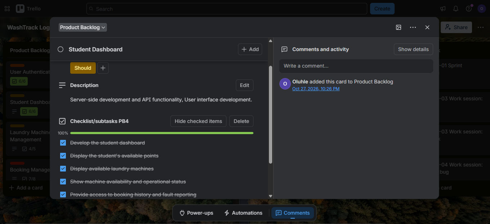
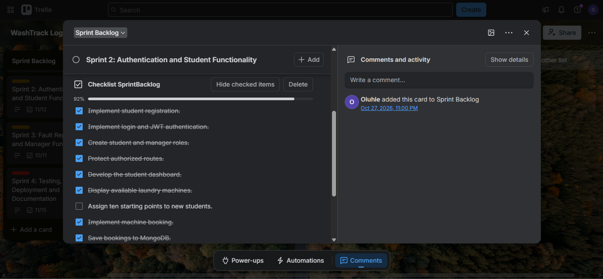
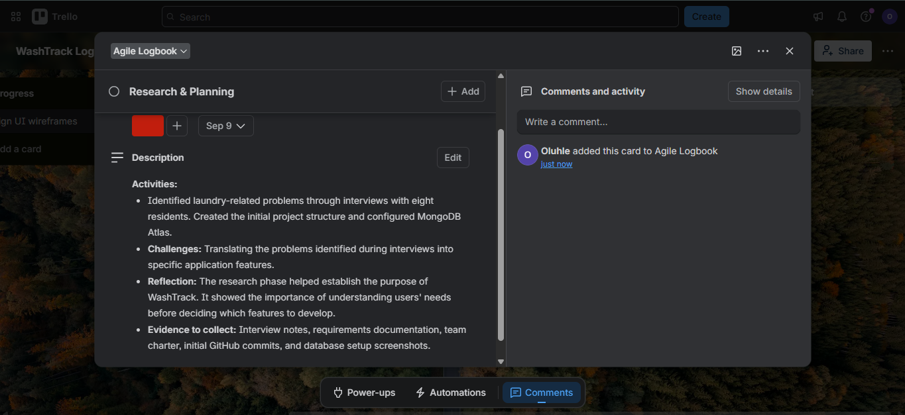

# OLUHLE MAKHAYE

📞 +27 67 675 7914  
📧 222419636@mycput.ac.za  
🔗 https://github.com/OluhleM  
📍 Willing to relocate  

---

## Professional Profile
Motivated ICT Application Development student with hands-on experience in software development, problem solving, and building practical systems. Currently completing a Diploma in ICT, with growing strengths in backend development, database design, and application architecture. 

Experienced in building layered systems using clean architecture, RESTful APIs, and object-oriented design. Previous experience as a firefighter brings discipline, composure under pressure, and strong teamwork.

---

## 🛠 Technical Skills
- **Languages:** Java, JavaScript, PHP  
- **Backend:** Node.js, Express.js, Spring Boot, REST APIs  
- **Frontend:** HTML5, React  
- **Databases:** MySQL, MongoDB  
- **Concepts:** OOP, Database Design, Error Handling, Triggers  
- **Tools:** Git & GitHub, Postman, IntelliJ IDEA, Figma  

---

## 📚 Education

**Diploma in ICT: Applications Development**  
Cape Peninsula University of Technology  
2022 – 2026  

**High School**  
Table View High School  
2020  

---

## 💼 Work Experience

### Wildland Firefighter  
**City of Cape Town**  
*Jan 2024 – June 2024*

- Responded to and managed wildland fires, ensuring effective containment  
- Followed strict safety protocols and worked closely within a team  
- Assisted with evacuations and hazard assessments  
- Operated firefighting equipment and maintained readiness  

---

## 📞 References

**Rethabile Molaoa**  
Supervisor, City of Cape Town  
📞 +27 72 577 0821  
📧 rethabile.molaoa@capetown.gov.za  

**Chey McDonald**  
Senior Firefighter, City of Cape Town  
📞 +27 65 612 5518  
📧 chey.mcdonald@capetown.gov.za

---
## 🎥 Mock Interview
<video src="oluhlem 222419636 mock interview.mp4" controls width="500"></video>

---

## 💻 Coding in Markdown Reflection

---

Learning how to code in Markdown was a refreshing experience. It felt different from the type of coding we are used to, which usually comes with strict rules and syntax requirements. Markdown, on the other hand, is simpler and more flexible.

One of the main challenges I encountered was formatting headings and applying **bold** and *italic* styles correctly. I also struggled with organizing my paragraphs using proper headings and highlighting key points effectively.

To overcome these challenges, I went online and researched how to format text in Markdown. After trying out what I found, everything worked exactly the way I wanted. I also discovered that there are multiple ways to format text and headings, which made the process even more interesting.

---

## 📹 Mock Interview Experience

The mock interview was one of the most challenging tasks I have undertaken, mainly because it required me to engage with myself critically.

I had to practise the interview questions, read them aloud to provide context as if I were addressing an employer, and then reflect on real-life situations that related to each question. I also had to structure my responses clearly and professionally, all while ensuring that the video was recording properly, capturing the full frame, and avoiding background noise from peers at res.

To manage the environment, I asked my roommate to excuse me for some time while I prepared and recorded the final version of the video. Fortunately, he had errands to attend to and left the room, which gave me sufficient time and a quiet space to complete the task.

As a result, I was able to conduct the mock interview effectively, leading to a successful submission.

---

## 🗞 Publishing on Github Pages

I was required to publish my work using GitHub Pages as part of the task. My goal was to follow the instructions provided in the subject guide and successfully get my project published online. I carefully followed the steps outlined in the guide. Whenever I was unsure about something, I searched online for clarification, which helped me stay on track and complete the process without major issues.

Overall, I did not find the task particularly difficult. The clear instructions and the ability to find additional help online made the process smooth and manageable.

---
## 🗒️WashTrack Agile Team Charter

#### Project Purpose:
WashTrack is a laundry management application designed to help students at New Market Junction monitor machine availability, book laundry machines, manage points, and report faulty equipment.

#### Team Goals:
Develop a functional and user-friendly application.
Implement student authentication, machine bookings, and points management.
Enable fault reporting and management.
Test and deploy a reliable application.

#### Core Values:
Collaboration:  Share ideas and support team members.
Accountability:  Take responsibility for assigned tasks.
Transparency:  Communicate progress and challenges.
Quality:  Test features before considering them complete.
Continuous Improvement:  Learn from feedback and mistakes.

#### Roles and Responsibilities:
Frontend: Develop the user interface.
Backend: Implement APIs, authentication, and application logic.
Database: Manage data storage and persistence.
Testing: Identify defects and verify functionality.
Documentation: Maintain project records and evidence.
Both responsible for everything and going over the next person's work.

#### Working Agreements:
Use Trello to organise and track tasks.
Use GitHub for version control and collaboration.
Break requirements into manageable user stories and tasks.
Communicate progress and technical challenges.
Test completed features and document important changes.

#### Decision Making
Technical decisions should be based on project requirements, functionality, and maintainability. Disagreements will be resolved through discussion and consideration of alternative solutions.

#### Definition of Done (DoD):
A task is complete when the functionality has been implemented, tested, and verified against its requirements. Relevant code and documentation must also be updated.

#### Continuous Improvement
The team will review progress, identify challenges, and apply lessons learned throughout development. This charter may be updated as project requirements and working practices evolve.

## 🪞 Reflection on Agile Charter:
Creating the Agile Team Charter helped me understand the importance of defining project goals, responsibilities, and working agreements. It established a common understanding of how the WashTrack team should collaborate, manage tasks, and maintain software quality. I also learned that an Agile charter is a living document that can be updated as the project evolves and new challenges arise.

---
## 👤 User Stories & Tasks

### User 1: 📱 Student Registration and Login

User story: As a student, I want to register and log in so that I can securely access WashTrack.

Tasks:

Develop registration and login functionality.
Implement JWT authentication.
Validate user credentials.
Restrict access to authorised users.

### User 2: 🤖 View Laundry Machines

User story: As a student, I want to view laundry machines and their status so that I can identify available machines.

Tasks:

Create machine database records.
Display machines on the student dashboard.
Show machine availability and fault status.

### User 3: Book a Laundry Machine

User story: As a student, I want to book and cancel laundry machines so that I can manage my laundry activities.

Tasks:

Implement booking functionality.
Save bookings to MongoDB.
Display booking history.
Implement cancellation and points refunds.

### User 4: ✴️ Manage Points

User story: As a student, I want to view my points balance so that I can monitor my available booking points.

Tasks:

Assign ten starting points to new students.
Deduct points when booking.
Update points after cancellation.
Display the current balance.

### User 5: 🤖 Report Faulty Machines

User story: As a student, I want to report faulty machines so that managers can address problems.

Tasks:

Develop a fault-reporting form.
Save reports to MongoDB.
Update machine status when a fault is reported.

### User 6: 🏗️ Test and Deploy WashTrack

User story: As a project stakeholder, I want a tested and deployed application so that users can access its functionality reliably.

Tasks:

Test authentication, bookings, points, and fault reporting.
Fix identified defects.
Configure MongoDB Atlas and environment variables.
Deploy the frontend and backend.
Verify the deployed application.

## 🪞 Reflection on User Stories & Tasks

Creating user stories and breaking them into smaller tasks helped me understand how Agile translates user needs into manageable development activities. Writing stories from the users' perspectives ensured that WashTrack's features addressed practical problems. Breaking each story into tasks also made development easier to organise, track, and test using Trello.

---
## 🖼️ Product Backlog: Trello
</img>

## 🪞 Reflection on Product Backlog

Creating the product backlog was challenging because I had to identify and organise the different features and requirements of WashTrack. There was a lot to consider, and prioritising the tasks required careful planning. However, I managed to work through the process and develop a structured list of requirements. This helped me understand the importance of prioritisation and planning in Agile development.

---
## 🏃🏾 Sprint Backlog: Trello
</img>

## 🪞 Reflection on Sprint Backlog

Developing the sprint backlog was challenging because I had to break larger features into smaller, manageable tasks and organise them according to development priorities. The process involved considerable planning, but I managed to complete it by focusing on the project's main objectives. I learned how sprint backlogs help organise workloads, monitor progress, and keep development focused on achievable goals.

---
## 🏃🏾 Agile Logbook: Trello
</img>

## 🪞 Reflection on Agile Logbook

Maintaining the Agile logbook was challenging because it required me to document development activities, challenges, progress, and lessons learned. Recording and organising the information took time, especially when reflecting on the different stages of WashTrack. Despite the workload, I struggled to complete the logbook to enterprise standard but completed it nonetheless. This experience taught me the importance of documenting progress and reflecting on challenges to identify areas for improvement in future projects.
